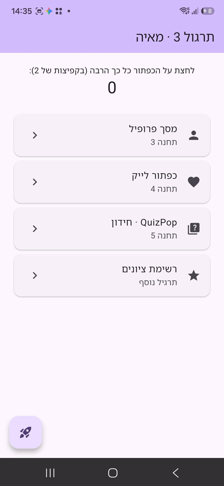
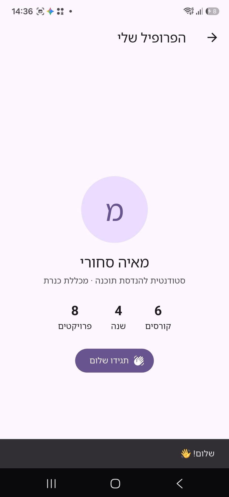
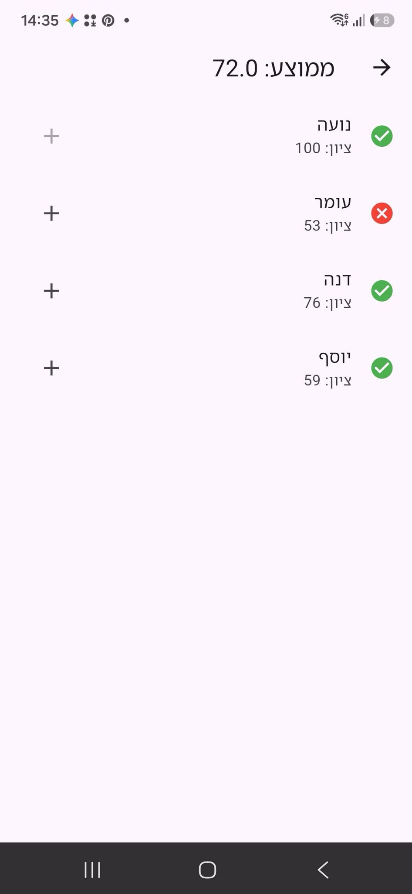

# תרגול 3 · QuizPop

| תחנה | מה נעשה | קובץ |
|---|---|---|
| 1 | שינוי כותרת, טקסט, אייקון וקפיצת המונה (2) | `lib/main.dart` |
| 2 | Dart: D1 ניחוש פלט, D2 פונקציות, D3 תיקון 3 באגים | `dart_exercises/` |
| 3 | מסך פרופיל עם השם שלי (T1) | `lib/screens/profile_screen.dart` |
| 4 | כפתור לייק: לב אדום ומונה שעולה ויורד (T2) | `lib/screens/like_screen.dart` |
| 5 | QuizPop: חידון בינה מלאכותית, 5 שאלות, ניקוד ומסך תוצאה | `lib/quiz/` |
| + | רשימת ציונים: ממוצע, ✓/✗ לפי ציון עובר 55, ＋/－ משנים ציון, וכפתור מיון מהגבוה לנמוך | `lib/screens/grades_screen.dart` |

## צילומי מסך (רץ על Samsung SM-S731B)
<p>
  
  
  
</p>

## הרצה
```bash
flutter create --platforms android,web .
flutter run
```
